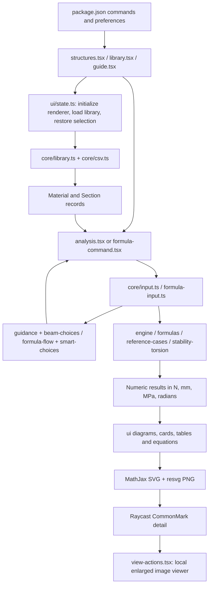

# Structural Toolbox — developer architecture and maintenance guide

This file explains the implementation as it exists on **23 October 2026**. Start here before changing calculations, input interpretation, CSV loading or diagrams. For installation and examples, see [README.md](README.md). For data columns, see [CSV-SCHEMA.md](CSV-SCHEMA.md). For independent checks and known source discrepancies, see [VALIDATION.md](VALIDATION.md) and [DATA-AUDIT.md](DATA-AUDIT.md).

## 1. What this application is

Structural Toolbox is a **local TypeScript/React Raycast extension**. It combines quick engineering calculations, a material/section library and explanatory graphics/equations. It is intended both as a calculator and a learning tool.

It has three registered Raycast commands:

| Manifest name | Entry file | Purpose |
| --- | --- | --- |
| `structures` | `src/structures.tsx` | Explicit launcher for beam/frame analysis, scalar calculators, torsion, buckling factors and the reference library. |
| `library` | `src/library.tsx` | One launcher with Materials, Sections and CSV Files pages. |
| `guide` | `src/guide.tsx` | In-app installation, input and engineering-method help. |

These are the commands in `package.json`. A source file does **not** become a Raycast command merely because it exists. `materials.tsx`, `sections.tsx` and `formulas.tsx` are compatibility/internal wrappers; do not register them again without deliberately deciding to reintroduce separate commands.

Current scope includes linear 2D frame/truss analysis, closed-form scalar/reference calculations, prismatic Vlasov torsion presets, elastic instability values and selected EC3/EC5 reduction factors. It does not calculate complete Eurocode design resistance, load combinations, interaction checks or design pass/fail results. The buckling factors are FYI below the elastic results. Torsion is a separate calculator, not an extra degree of freedom in the 2D frame engine.

## 2. First orientation: which files should I edit?

| Desired change | Start with | Usually also inspect |
| --- | --- | --- |
| Raycast command names, preferences, icon or supported platforms | `package.json` | `structures.tsx`, `guide.tsx`, `assets/icon.png` |
| Which calculators appear on the Structures start screen | `src/structures.tsx` | `core/formula-presentation.ts`, `core/formulas.ts` |
| Beam system, support, load or pitch input | `core/input.ts`, `core/beam-choices.ts` | `core/guidance.ts`, `analysis.tsx` |
| Material and section suggestion ranking | `core/smart-choices.ts` | `core/library.ts`, `ui/choices.tsx` |
| Small calculator input order and hints | `core/formula-flow.ts`, `core/formula-examples.ts` | `core/formula-input.ts`, `formula-command.tsx` |
| A scalar equation or its numeric output | `core/formulas.ts` | `ui/equations.ts`, `ui/formula-overview.ts` |
| Euler FYI, LTB, St. Venant or warping mathematics | `core/stability-torsion.ts` | `core/formulas.ts`, `tests/stability-torsion.test.ts` |
| New torsion/LTB input option or unit | `core/engineering-input.ts` | `core/formula-input.ts`, `ui/engineering-options.tsx` |
| FE stiffness, releases, recovery or reactions | `core/engine.ts` | `core/templates.ts`, `core/types.ts`, engine/manual tests |
| Bending/shear deformation split | `core/deformation.ts` | `core/engine.ts`, `ui/response-charts.ts` |
| Section geometry or derived A/I/W/J | `core/sections.ts` | `core/section-properties.ts`, geometry/source audits |
| A section property's meaning, aliases or learning equations | `core/section-properties.ts` | `ui/section-properties.ts` |
| Add or edit a library record | Active personal CSV folder, not generated JS | `CSV-SCHEMA.md`, `core/library.ts` |
| Beam/support/load/reaction drawing | `ui/beam-scene.ts` | `core/diagram-vectors.ts`, `core/diagram-layout.ts` |
| Filled moment/shear/deflection plots | `ui/response-charts.ts` | `ui/drawings.ts`, `core/presentation.ts` |
| Fonts, colours, card spacing | `ui/visual-style.ts`, `ui/panels.ts` | All diagram renderers; check light/dark and 430 px width |
| Torsion/LTB/factor plots and worked output | `ui/stability-torsion.ts` | `ui/engineering-options.tsx`, `ui/equations.ts` |
| Enlarge image / zoom / pan / popup | `ui/view-actions.tsx` | Call sites in formula, analysis, library and reference views |
| A photographed/reference beam case | `core/reference-cases.ts` | `reference-library.tsx`, `tests/reference.test.ts` |
| Installation or development import | `Install.cmd`, `package.json` scripts | `dist/` only to inspect the output; never hand-edit it |

## 3. Folder layout and what is generated

```text
structural-toolbox/
  package.json                 Raycast manifest, preferences and npm scripts
  package-lock.json            Reproducible dependency versions
  tsconfig.json                Strict TypeScript configuration
  raycast-env.d.ts              Types generated by the Raycast toolchain
  Install.cmd                  Windows setup/check/build/develop launcher
  README.md                    User-facing overview and examples
  ARCHITECTURE.md              This developer map
  CSV-SCHEMA.md                Library file/column conventions
  VALIDATION.md                Independent mathematical and UI checks
  DATA-AUDIT.md                Known discrepancies and data provenance
  LICENSE
  src/                         Editable application source
    core/                      Numerical methods, parsers and data models
    ui/                        Rendering, shared UI and persistence helpers
  assets/
    icon.png, icon.svg         Transparent extension icon/source
    library/                   Bundled starter library CSVs
    reference-en1995/          Reference tables; not all are active runtime inputs
    renderer/                  resvg.wasm, Roboto.ttf and font licence
  tests/                       Independent calculations, parser and UI scenarios
  scripts/audit-data.py        Supporting data audit script
  dist/                        Generated Raycast bundles and copied assets
  node_modules/                Installed dependencies; regenerate with npm ci
```

Edit `src`, the manifest, documentation or the appropriate source CSV. Rebuild to generate `dist`. A fix applied only to `dist/structures.js` disappears at the next build/develop run.

The npm lockfile is the version authority. At this revision it locks Raycast API **1.104.25**, React **19.3.1**, MathJax **3.2.2**, resvg WASM **2.6.2**, TypeScript **5.9.3**, esbuild **0.27.7**, tsx **4.23.15** and Prettier **3.9.10**. `package.json` declares compatible ranges; `npm ci` installs the lockfile versions.

## 4. APIs, dependencies and runtime boundaries

There is **no remote calculation server, database service, AI model call or Dlubal API call**. Calculations and library reading run locally. Engineering source websites are references and data provenance, not live runtime dependencies.

| API/library | Used for | Important source locations |
| --- | --- | --- |
| `@raycast/api`: `List`, `List.Item.Detail`, `Detail` | Native navigation/list rows and CommonMark result panes | Command components and `ui/choices.tsx` |
| `@raycast/api`: `Form`, `Action`, `ActionPanel` | Editors, selection, copy/save/open actions | `analysis.tsx`, `formula-command.tsx`, `library.tsx` |
| `useNavigation()` | Explicit `push` / `pop` between views | All command components |
| `getPreferenceValues()` | User preferences defined in the manifest | `ui/state.ts` |
| `environment.assetsPath` | Locate bundled CSV, WASM and font files | `ui/state.ts`, `ui/raster.ts` |
| `environment.supportPath` | Personal data, saved calculations and generated previews | `ui/state.ts`, `ui/view-actions.tsx` |
| `environment.appearance` | Select light/dark diagram palette | `ui/visual-style.ts`, equation rendering |
| Raycast `LocalStorage` | Last selected material/section under key `selection` | `ui/state.ts` |
| Raycast `open()` / file and preference actions | Open a generated viewer, PNG, CSV folder or extension settings | `ui/view-actions.tsx`, `library.tsx` |
| `showToast()` | Visible validation/open/save failures | UI components and `ui/common.tsx` |
| React state/effects | Query, selection, editor state and async library initialization | Command components, `ui/state.ts` |
| Node `fs`, `path`, `crypto`, `url` | CSV/JSON access, content hashes, local preview files and file URLs | Library, state, image/view helpers |
| `mathjax-full` | TeX → SVG equation graphics | `ui/equations.ts` |
| `@resvg/resvg-wasm` | SVG → PNG with the bundled font | `ui/raster.ts` |
| `esbuild`, `tsx`, TypeScript | Build, typecheck and test execution | npm scripts and host UI test runner |

Official API references: [Raycast List](https://developers.raycast.com/api-reference/user-interface/list), [Detail](https://developers.raycast.com/api-reference/user-interface/detail), [Actions](https://developers.raycast.com/api-reference/user-interface/actions). Check the locally installed SDK types in `node_modules/@raycast/api/types/index.d.ts` when implementing platform-specific behaviour.

Raycast owns the native window and right pane. The extension does not provide an HTML webview there and cannot attach a custom wheel/pinch event handler to native `Detail`. The zoom viewer described below is therefore a generated local HTML document opened in the default browser. It currently does **not** use Raycast Quick Look.

## 5. Application data flow



The practical separation is:

1. **Parser:** interpret text and units; record which values were actually supplied.
2. **Guidance:** choose the next missing input and rank suggestions.
3. **Mechanics:** calculate from explicit numerical values; no React or Raycast view logic.
4. **Presentation:** format labels, explanations, equations and diagrams from those results.

Some core modules such as the library loader use Node filesystem APIs. The numerical engine itself does not need Raycast. Keep new mathematical functions independently testable.

## 6. Source file inventory

### 6.1 Command/view components

| File | Responsibility |
| --- | --- |
| `src/structures.tsx` | Start-screen rows, calculator search, examples and explicit navigation. |
| `src/analysis.tsx` | Beam/frame command orchestration: query, guided choices, model/editor state, analysis calls, relevant result rows and save/restore. |
| `src/formula-command.tsx` | Formula browser and `FormulaCalculator`; merges presets with input/overrides, checks readiness, renders results and opens `FormulaEditor`. |
| `src/formulas.tsx` | Re-export of the formula command for internal/compatibility use. |
| `src/reference-library.tsx` | Browse and calculate standard beam arrangements; reference-specific inputs and outputs. |
| `src/library.tsx` | Unified Library UI, material and section filtering/editors, CSV status/reload and handoff to calculators. |
| `src/materials.tsx`, `src/sections.tsx` | Small category wrappers around Library; not independently registered commands. |
| `src/guide.tsx` | Exported `GUIDE` text and its Raycast `Detail` view. Keep it aligned with the README when workflows change. |

### 6.2 Core models, parsing and guidance

| File | Responsibility |
| --- | --- |
| `core/types.ts` | `Material`, `Section`, `Node`, `Member`, `Model`, loads, stations and results. Primary contract for the FE and presentation layers. |
| `core/csv.ts` | CSV parsing/writing and numeric field extraction. Preserve quotes, blanks and row/column meanings. |
| `core/library.ts` | Disk loading/merging, material aliases/family matching, fuzzy scores, material suitability, property units and fresh-library migration. |
| `core/concrete.ts` | Concrete reference rows and recognition of old bundled example records. It does not calculate reinforced-concrete design resistance. |
| `core/sections.ts` | `sectionFromRow`, `customSection`, section geometry, centroidal/principal inertias and geometric property defaults/overrides. |
| `core/section-properties.ts` | Property definitions, groups, aliases, equations, explanatory metadata and available values. Also lists derived-property fields that must be invalidated after geometry edits. |
| `core/input.ts` | `quantity`, `parseQuick`, `parseSection`, `spansInput`, `pointLocation` and annotation stripping. The general beam/library grammar and basic unit conversion live here. |
| `core/guidance.ts` | Missing-input guidance, geometry field names and editable shape examples. |
| `core/beam-choices.ts` | Beam-specific system → span → pitch/direction/load → material → section flow and confirmation choices. |
| `core/smart-choices.ts` | Shared material/section family suggestions, grade preferences, exact/custom geometry and L/20 ranking. |
| `core/formula-input.ts` | Module-specific scalar parsing and conversion into `FormulaValues`; optional engineering fields and restraint keywords. |
| `core/formula-flow.ts` | `formulaStage` and `formulaChoices`; context-specific missing values, cases and suggestions. |
| `core/formula-examples.ts` | Central examples and primary required inputs per calculator. Update this when changing inputs. |
| `core/engineering-input.ts` | New engineering parameter labels/units, per-calculator optional keys and string-to-enum mappings. |
| `core/formula-presentation.ts` | Short list labels and search aliases; keeps the left pane readable without losing full engineering titles. |
| `core/presentation.ts` | Human member names, active/relevant responses and common result interpretation. |
| `core/diagram-layout.ts` | Pure geometry for consistent system/response plot positions. |
| `core/diagram-vectors.ts` | Signed reaction and moment-arrow geometry. Zero values produce no arrow. |

### 6.3 Calculation implementations

| File | Responsibility |
| --- | --- |
| `core/templates.ts` | `AnalysisInput` and `buildModel`: turn user systems into nodes, members, supports and loads. Includes inclined/roof/truss geometry, projected loads and self-weight options. |
| `core/engine.ts` | 2D direct-stiffness FE assembly, local/global transformation, releases, equivalent loads, solution, reactions and internal response recovery. |
| `core/deformation.ts` | Effective energy shear areas; populate shear stiffness; compare Euler and Timoshenko solutions at matching stations. |
| `core/stresses.ts` | Recover supported section stress distributions, normal/shear extrema and associated geometry checks. |
| `core/formulas.ts` | `Formula`, `FormulaValues`, `Answer`, scalar formula definitions and `calculate` validation. Euler remains here; new torsion/LTB definitions delegate to the engineering module. |
| `core/formula-catalog.ts` | Visible formula catalogue, standard beam additions and result-specific formula entries. The old standalone modulus function is deliberately excluded from visible navigation. |
| `core/reference-cases.ts` | 92 reference arrangements and an independent equilibrium/compatibility calculation path, plus reference-model construction. |
| `core/stability-torsion.ts` | Column factors, reduction curves, Mcr/LTB factors, St. Venant section stress/twist and exact prismatic Vlasov torsion presets. |

### 6.4 Shared UI/rendering

| File | Responsibility |
| --- | --- |
| `ui/state.ts` | Preferences, personal library directory/seeding, renderer/library hook, remembered presets, number formatting, SVG raster cache and saved calculations. |
| `ui/common.tsx` | Error view and common error reporting. |
| `ui/choices.tsx` | Convert `Choice[]` into grouped selectable rows and candidate material/section previews. |
| `ui/input-help.ts` | Readable explanatory input text for beam analysis. |
| `ui/visual-style.ts` | Shared 560-unit detail width, theme palette, readable font sizes, escaped SVG labels and wrapping. |
| `ui/panels.ts` | `metricCards` and `parameterChips`; shared rounded cards and parameter layout. |
| `ui/beam-scene.ts` | System, supports, applied loads and signed reaction arrows/labels. Preserve physical X/Z scale for pitch. |
| `ui/response-charts.ts` | Filled response plots, common member boundaries, axis labels and total/bending/shear deformation overlays. |
| `ui/drawings.ts` | High-level section, system, formula, reference and dashboard image composition; delegates scenes/charts and specialised new sketches. |
| `ui/formula-overview.ts` | Scalar result/equation/sketch panels and the original two-axis Euler overview. |
| `ui/section-properties.ts` | Grouped property tables, focused property teaching content, equations and section illustrations. |
| `ui/stability-torsion.ts` | New torque/LTB sketches, stress locations, torque/twist/bimoment plots, reduction curves, Euler FYI, worked substitutions and focused result rows. |
| `ui/engineering-options.tsx` | Optional engineering editor fields, restraint/load-case selectors and form-to-options reading. |
| `ui/equations.ts` | TeX mappings, MathJax SVG generation, equation PNGs and property/equation naming. |
| `ui/raster.ts` | Initialize the bundled WASM/font renderer and rasterize SVG at the requested width/default 1.5× scale. |
| `ui/view-actions.tsx` | Select the relevant image, PNG export, full-width in-app diagram popup, reading view, optional local browser viewer and zoom/pan controls. |

Known presentation coupling: `drawings.ts` and `ui/stability-torsion.ts` currently reference each other through the specialised sketch and common section drawing. They invoke these functions after initialization. Do not introduce top-level drawing calls across that cycle; extracting shared sketch primitives is the natural future cleanup.

## 7. Units, axes, signs and result contracts

### 7.1 Unit boundaries

| Quantity | User-facing default | Numerical core |
| --- | --- | --- |
| Member/span/unbraced length | m | mm |
| Section dimensions, signed load height `zg` | mm | mm |
| Force | kN | N |
| Distributed load | kN/m | N/mm; numerically the same value |
| Bending moment / torque | kN·m | N·mm |
| Bimoment | kN·m² output | N·mm²; divide by `1e9` for display |
| E/G/strength/stress | MPa | N/mm² |
| Area | mm² | mm² |
| Elastic/plastic/torsional stress modulus | mm³ | mm³ |
| I/J | mm⁴ | mm⁴ |
| Warping stress modulus `Ww` | mm⁴ | mm⁴ |
| Warping constant `Iw` | mm⁶ | mm⁶ |
| Rotation/twist | degrees or degrees/m in output | radians or radians/mm |

`quantity()` is a boundary helper, not a universal internal-unit function: its `length` result is metres and its `force` result is kN. `formulaScalar()` converts those to mm/N. `buildModel()` likewise converts public analysis inputs before passing them to `analyze()`.

Supported moment text includes `kNm` and `Nmm`; do not assume every equivalent spelling such as `Nm` is accepted. Extend the unit map and tests together when adding one. Commas separate values, so decimals use a point. The power-property parser handles mm/cm/m with powers 3/4/6 for the corresponding fields.

### 7.2 Axes and signs

- Member x is longitudinal. Cross-section y is horizontal and z vertical in the section sketch. `Iy = integral(z² dA)` and `Iz = integral(y² dA)`. “Buckling about y” uses Iy.
- The FE system is in global X/Z with one out-of-plane rotation per node; a frame member has `[uX, uZ, rotation]`. Node restraints use that same order.
- Positive axial N is tension. Signed transverse/moment results follow the engine convention. The beam UI interprets an unsigned ordinary load as downward; formula reference magnitudes use their documented positive-down convention.
- A local transverse load rotates with the member. A global load keeps its global direction. Projected UDL is per horizontal metre, not per inclined member metre. Do not confuse direction with load-length basis.
- Warping uses `T = Tsv + Tw`, `Tsv = GJ theta'`, `B = -E Iw theta''`, `Tw = B'`. Its reaction B is the generalized support force conjugate to the warping slope DOF; follow the explicit boundary signs in the implementation.
- Response extrema may occur at different stations. Add bending and shear deformation only at the **same** station. Do not combine independent torsional stress peaks into a same-point equivalent stress.

`Material.raw` and `Section.raw` retain original CSV strings, source fields and optional properties. Derived numeric fields belong to the parsed objects. Keep full precision in calculations and round only in presentation via `fmt()`.

## 8. Which engine calculates which result?

### 8.1 Flexible beam/frame/truss analysis

`analysis.tsx → buildModel() → analyze()` is a linear 2D FE/direct-stiffness path.

The engine assembles local frame or axial-truss stiffness, transforms to global coordinates, applies restraints and statically condenses rotational releases. Member loads produce consistent nodal loads. The scaled/pivoted linear solve rejects mechanisms rather than adding artificial stabilizing stiffness. Response recovery includes distributed-load particular solutions, load discontinuities and critical stations, so a distributed-load displacement is not merely an interpolated cubic between nodal results.

Continuous interactive models support up to five spans. Roof rafters have the specified pin-pin eaves/hinged ridge geometry without a bottom tie by default. A true axial truss accepts joint loading; distributed loading along a rafter needs frame members if bending is to be represented.

`deformationParts()` runs the Euler and Timoshenko models and compares their displacement fields at matching stations. “Shear increment” is Timoshenko minus Euler. In indeterminate systems it also includes the effect of force redistribution, so it is not universally an independent pure-shear curve. Supplied/modeled energy shear area is separate from a plastic strength shear area.

### 8.2 Scalar and reference formulas

`Formula.compute()` returns `Answer[]` with label, numeric value, unit, equation and optional substitution. `calculate()` validates inputs first. Beam formulas and reference arrangements state their support/loading assumptions.

The reference library has its own equilibrium/compatibility calculation path. Keep it independent of the production FE assembly: agreement between two genuinely different implementations is useful verification. Reference arrangements can include equal-span cases beyond the flexible UI's five-span limit; those are separate explicit reference cases, not a changed interactive-model limit.

### 8.3 Euler buckling and FYI

The existing `euler` formula remains the top elastic result. A selected section yields y/z, or principal u/v when Iyz couples the section axes. Explicit single I input yields a single result; it does not invent the other axis. K is common unless Ky/Kz are supplied. An explicit single-I calculation uses K, not Ky/Kz.

`columnFactors()` supplies the separate material FYI block:

- EC3: relative slenderness and chi, separately per flexural axis. Gross A is the Class 1–3 reference; a supplied effective A can be selected. Curve b/alpha 0.34 is a visible editable assumption, not automatic section classification or product-route identification.
- EC5: use E0,05 and fc0,k for each axis, with beta_c and kc. These characteristic-stiffness Ncr values are shown in the FYI block and can differ from the displayed-E Euler results above.
- Steel presets without fy retain their existing CSV values. A nominal grade fy is offered as a selectable suggestion; actual product/thickness strength must be supplied/confirmed before factors appear.
- Asymmetric flexural results do not claim to cover torsional or flexural-torsional column buckling.

### 8.4 LTB

`lateralBuckling()` is an analytical critical-moment calculator, **not** a 3D FE eigenvalue solver.

Steel/general Mcr uses a prismatic doubly symmetric expression with J, Iz, Iw, load height and restraint factors. Presets assume fork supports and k=kw=1: uniform moment, UDL or a central point force. UDL C1/C2 are 1.127/0.454 and central point values 1.348/0.630 from NCCI SN003b Table 3.2. Custom coefficients must match the intended restraints/loading. Tees, channels and angles are rejected by this model. Do not silently apply the doubly symmetric expression to them.

Steel factor output uses the first-generation EC3 **general** LTB curve, 6.3.2.2. Elastic/plastic/supplied-effective modulus basis is explicit. The alternative rolled-section method in 6.3.2.3 is not implemented.

Timber kcrit currently supports solid rectangular member geometry and the EC5 effective-length method with E0,05/G0,05. Presets use leff/Lb of 1.0, 0.9 and 0.8 for uniform moment, UDL and a central point force at the centroid. Custom timber length is the effective length; load-height/restraint corrections belong in it. Do not use mean E/G silently for this code factor.

### 8.5 St. Venant torsion

`stVenant()` returns section-appropriate shear stress, twist rate and optional total twist. It uses circular/annular elasticity, a converged rectangle series, Bredt's thin-wall closed-cell model, or an open thin-strip approximation as appropriate. A supplied Wt can specify maximum stress. J is a stiffness property and does not, by itself, define peak shear stress for an arbitrary section.

For a solid rectangle, `rectangleTorsion()` computes a consistent series J and stress coefficient unless an explicit J is supplied. The ordinary section library's geometric J may use its separately labelled engineering approximation. Uniform scalar G is assumed; a timber application needs an appropriate effective torsional shear modulus.

### 8.6 Restrained warping torsion

`warpingTorsion()` solves the **exact linear prismatic one-dimensional Vlasov problem** for one point torque. It does not mesh a new FE model. An exponential basis solves constant-torque segments without cosh overflow, enforcing end restraints, continuity and the torque jump. Critical points are added for twist, bimoment and torque-component extrema.

The supported numeric case values are stable parser/editor contracts:

| `torqueCase` | Input phrase | Meaning |
| --- | --- | --- |
| 0 | `cantilever restrained` | Twist and warping restrained at A; free B. |
| 1 | `cantilever free` | Twist fixed, warping free at A; free B. |
| 2 | `fork free` | Both end twists fixed; warping free at both ends. |
| 3 | `both restrained` | Both end twists and warping restrained. |

Omitted torque position is the tip for a cantilever and centre for two-end cases. `at 40%`, `at 0.4L` and `at 2m` are accepted. A torque directly at a twist-fixed support is either reacted locally or explicitly rejected by the corresponding preset; it is not silently moved into the span.

Results include theta(x), Tsv(x), Tw(x) and B(x). Normal stress requires Womega or supported sectorial geometry. Ideal symmetric I-flange recovery supplies omega_max and Somega for normal/warping shear stress; fillet/junction stress concentrations are excluded. Known Iw=0 directs the user to St. Venant torsion. Unknown properties remain unknown, rather than being replaced with zero.

## 9. Input, hints and state management

### 9.1 Beam flow

The guided sequence is system → span(s) → pitch when relevant → direction/UDL basis when relevant → load → material → section. Full expressions can still be interpreted in a different order when names/units make them unambiguous. A bare load number should offer a unit/type choice; it must not silently guess between kN and kN/m.

`smartChoices()` ranks suggestions; it does not apply them. Enter confirms the highlighted choice and inserts canonical text. Family rows let users narrow steel sections without showing the entire catalogue. L/20 is a starting-depth heuristic, not load-based optimization. The exact size entered by the user always wins.

Fuzzy matching applies to names and keywords. Grade numbers, dimensions and magnitudes must not be “corrected” to another number. Material matching must take precedence over coefficient parsing: the regression case is **C24 must not become C2=4**.

### 9.2 Formula flow

`FormulaCalculator` maintains query, selected row, context and property-category state. Context holds the selected material/section, previous values, optional overrides and confirmation flags. `merged()` builds a complete numerical candidate while preserving the distinction between a suggested preset and a confirmed input.

`parseFormulaInput()` returns parsed values, material/section matches, errors and a `provided` set. `formulaStage()` decides what is missing. `formulaChoices()` suggests canonical tokens. A preview may show a suggested choice but must label it as a preview; moving selection must not silently commit a material or section.

Torsion-warping and LTB first offer their restraint/load cases. New optional engineering fields are registered in `engineeringFields` and `engineeringKeys()`. Their numeric enums and keyword aliases are in `engineeringKeywordValues`.

**Never navigate from a dropdown's initialization or generic selection callback.** Navigation belongs to an explicit action. This prevents the earlier Structures screen from briefly opening and disappearing into an unrelated calculator. Changing the beam dropdown changes the system only.

## 10. CSV storage, precedence and editing

### 10.1 Three different locations

1. `assets/library/`: bundled starter files. Editing them affects a newly seeded personal library, not an existing personal copy.
2. Active personal folder: the runtime source of truth. It is the optional `libraryDirectory` preference, or `environment.supportPath/library` when blank. **Library → CSV Files** shows its resolved path and loaded files.
3. `assets/reference-en1995/`: preserved reference/design tables. They are not automatically merged into the active material/section library. Their presence does not mean EC5 design checks are implemented.

`libraryDirectory()` copies missing base/extra bundled CSVs, never overwrites an existing file during seeding, and performs the documented migration on a newly created base library. `loadLibrary()` reads disk; it is not a hardcoded JSON preset array. Reload after external CSV edits.

### 10.2 File discovery and duplicate IDs

The loader reads `materials.csv` and `sections.csv`, plus matching `materials-*.csv` and `sections-*.csv` files. Extra files are sorted. Base-record IDs win against extra files; among extras, the first encountered ID wins case-insensitively. Rows within a base file should still have unique IDs—do not rely on the merge rule to clean a malformed base file.

Section families and matching choices are driven by loaded records, so extra CSVs can introduce families/sizes without editing a fixed dropdown. New shape **geometry types**, however, require code changes; a family label does not teach the geometry engine a new shape.

### 10.3 Optional and derived properties

- Preserve blank for unknown optional values. Explicit zero can have a physical meaning, such as supplied Iw=0.
- Keep J, Iw, Wt and Womega distinct, including their units.
- Keep energy shear areas Asy/Asz distinct from code/plastic shear areas Av,y/Av,z.
- Do not fabricate net/effective area, effective section modulus, sectorial data or catalogue fillet first moments.
- Geometry edits must clear stale derived/catalogue overrides. `optionalSectionPropertyFields` supports that invalidation.
- New torsion calculations prefer an explicit J override or supplied CSV J; otherwise they use the section geometry/default. The source metadata remains available.
- Do not silently “repair” existing catalogue numbers. The project's established workflow is to report a suspected source error before changing existing CSV values. Retain source URLs and audit fixtures when an approved correction is made.

The bundled unique library currently has 48 materials and 713 sections. Those are a checked release fixture, not a production limit.

## 11. Graphics, equations, zoom and caching

### 11.1 Native result pane

The UI builds SVG strings, rasterizes them to PNG and embeds `data:image/png;base64,...` in CommonMark. `svgFile()` stores a content-hashed PNG in `supportPath/drawings` and maintains a bounded in-memory image cache. `initializeRenderer()` must complete before drawing. It loads WASM and the bundled font using `environment.assetsPath`.

MathJax converts TeX to SVG, then the same raster pipeline produces equation PNGs. Thus equations do not depend on the host's current native LaTeX support. The equation cache includes appearance/font state. Do not silently catch a MathJax error and display a plausible equation from another calculator.

The common canvas is 560 units wide. The default readable label size is 22, with compact/large preferences; the actual Raycast pane may be narrower. Inspect at approximately 430 px display width. Wrap labels and allocate space instead of shrinking all text. Preserve common X/Z scaling in pitched geometry and label independent plot scales. Filled force plots and total/bending/shear curve styles convey meaning even in a narrow pane.

SVG label helpers escape external/user text. Continue escaping IDs, record names and units inserted into graphics. Renderer setup uses Roboto from `assets/renderer`, not a guaranteed operating-system font.

### 11.2 Enlarged viewer

`diagramFromMarkdown()` prefers an overview/section/diagram over the first equation image. `saveDiagramImage()` exports an opaque PNG with the correct theme background and original pixel dimensions.

`saveDiagramViewer()` writes a standalone HTML document under `supportPath/diagram-previews`. All image bytes are embedded. A restrictive CSP permits the document's own inline viewer code/styles and data images, with no remote scripts/resources. It opens with Raycast's `open()` in the OS default browser.

Inline diagrams must be **bare PNG markdown**, never images wrapped inside a file link: the linked-image version caused native Windows scaling/clipping. `previewMarkdown()` now preserves bare images and strips legacy file-link wrappers. It creates no viewer file during inline rendering.

`EnlargeDiagramRow` is a visible row in calculated beam/formula views, and enlargement is the primary action on calculated Overview rows. It pushes `DiagramPreview`, an image-only full-width Raycast Detail with one PNG. Next/Previous Diagram updates the selected image in that view. It does not need an OS browser or file association to open.

The popup offers the built-in `Action.OpenInBrowser` with a local file URL for optional browser zoom; its `#diagram=N` fragment selects the current plot. The browser viewer provides fit width, 100%, +/−, Ctrl+wheel, drag panning, full screen and a diagram selector. PNG opening uses built-in `Action.Open`; Copy Image Path is also available. These external fallbacks are separate from the in-app popup.

**Open Full View** is a full-width Raycast reading view; it is not real zoom. **Open Diagram Image** remains a default-PNG-viewer fallback. Native Raycast/OS launch behaviour needs a native check; DOM/component tests cannot prove it. Regression checks assert that native image markup has no link wrapper and that the Enlarge action navigates to an image-only Detail.

## 12. Preferences, remembered state and saved calculations

| State | Storage | Maintenance note |
| --- | --- | --- |
| CSV folder, default material, precision, diagram size | Raycast preferences from `package.json` | Preserve preference names/types when possible. |
| Last material/section | Raycast `LocalStorage`, key `selection` | Includes raw custom-section data for fallback restoration. |
| Saved calculations | `supportPath/calculations.json` | Up to 100 records with kind, title, timestamp, input/context and library hash. |
| Raster PNGs | `supportPath/drawings/` | Generated content, not editable source. |
| Export PNGs/local HTML | `supportPath/diagram-previews/` | Generated content; no web server is needed. |

Current limitation: `snapshotLibrary()` hashes the two base CSVs, not every extra `*-*.csv` catalogue. The saved context also contains selected records, but the hash must not be advertised as a complete fingerprint of every loaded file. Extending that fingerprint requires a compatibility-aware change and tests. File-based save writes are also not a multi-process transactional database.

The old scalar `modulus` definition remains for saved snapshot compatibility, while its duplicate visible command/catalogue entry is removed. Preserve stable formula IDs and option enum values or provide migration when changing stored calculations.

## 13. How to extend the application

### 13.1 Add a scalar calculator

1. Add pure numeric logic and independent expected values; use a separate core module if the method is substantial.
2. Add a stable `Formula` ID/definition in `core/formulas.ts`. Specify required inputs, assumptions, outputs and units. `Answer.value` should be finite whenever calculation succeeds.
3. Register any new value fields in `FormulaValues`, unit parsing/display, input names and examples. For advanced optional values, update `core/engineering-input.ts` and editor fields.
4. Update `formulaStage`/`formulaChoices` if the new module needs a different input order. Defaults are visible suggestions, not proof of confirmed material/geometry.
5. Add the short label/search aliases and an explicit Structures launcher row if it should be directly accessible.
6. Add a typeset equation in `ui/equations.ts`, a truthful preview/sketch and appropriate result presentation. Hide unsupported outputs rather than showing meaningless unavailable rows.
7. Exercise a full example, Enter-only flow, custom data, invalid input and relevant sign/unit cases. Update the Guide/README.

### 13.2 Add a torsion/LTB option

Update `EngineeringOptions`, `engineeringFields`, `engineeringKeys`, keyword mappings if applicable, `formulaScalar` conversion, option form, merged defaults, mathematical validation and worked output. If an option changes restraints or required information, update the guidance too. A parser accepting a parameter that the solver silently ignores is a bug.

### 13.3 Add a material or catalogue family

Add reviewed rows to the appropriate active CSV or a new matching extra file. Use stable unique IDs, supported shapes and explicit units/source. Reload. Verify that aliases/family suggestions are sensible, optional fields are hidden when absent, and a representative value matches an independent source. A new family usually needs no code change.

For a new geometric shape, additionally update the `Shape` union, geometry validation/property derivation, parser aliases/dimension order, guidance/editor fields, drawing, stress and shear-area models, optional torsion support and shape-specific tests. Do not enable a formula merely because a shape can be drawn.

### 13.4 Add a beam system/load case

For flexible analysis, update parser/guidance, `AnalysisInput`/templates and the editor; change the engine only if the numerical capability is genuinely new. Add equilibrium and compatibility comparisons. For a standard reference case, update the reference definition/independent method, illustration and reference tests. Do not turn a true axial truss into a bending frame silently to accommodate a member UDL.

### 13.5 Add future design checks

Keep factor finding in the current calculators. Put complete code resistance, combinations, interaction and utilization logic in a separate core design layer with an explicit edition/National Annex basis and required design inputs. Share Material/Section data, but do not mix design partial factors or reduced strengths into the elastic FE stiffness path without a defined analysis method. Add project-specific inputs such as service class, load duration or section class only when the check actually uses them.

## 14. Tests and verification map

Run from the project root:

```text
npm ci
npm run typecheck
npm test
npm run test:ui
npm run build
```

The numerical/input/data suite currently contains 368 passing cases. Test count alone is not proof of engineering validity; preserve independent methods and source comparison.

| Test area | Files |
| --- | --- |
| Frame/truss mechanics, equilibrium, reactions and releases | `engine.test.ts`, `expanded-toolbox.test.ts` |
| Euler/Timoshenko recovery and same-station deformation | `deformation-curves.test.ts` |
| Independent formula integration/compatibility | `manual-audit.test.ts` |
| Reference arrangements and frozen external comparisons | `reference.test.ts`, `reference-benchmarks.json` |
| Section stresses | `stresses.test.ts` |
| Geometry, principal properties and catalogue values | `geometry-audit.test.ts`, `section-learning.test.ts`, `steel-catalogue.test.ts` |
| Source table fixtures and earlier audit results | `steel-source-fixtures.json`, `data-audit-results.json` |
| Library/formulas and disk reload/merge | `library-formulas.test.ts`, `csv-loading.test.ts` |
| Beam guidance, typo handling, material/section suggestions | `beam-flow.test.ts`, `guidance.test.ts`, `smart-input.test.ts` |
| Scalar parsing, missing inputs and examples | `formula-input.test.ts`, `formula-flow.test.ts` |
| Signed arrows and scale/layout geometry | `diagram-layout.test.ts` |
| Torsion, warping, Mcr, reductions, factors, units and supported limits | `stability-torsion.test.ts` |
| React flow/navigation and rendered output | `host-smoke.mjs`, `ui-scenarios.tsx` |

The host smoke runner uses esbuild plus a small Raycast/React adapter. It exercises actual rendering and handler functions with the real WASM/font/MathJax pipeline, but does not run the native Raycast window. The generated HTML viewer script is executed with a DOM adapter to check zoom, fit, pan, plot selection and clicked-image fragments. These checks do not verify the OS default-browser association, native markdown link handling or native focus/keyboard behaviour.

Optional PowerShell examples for visual checks:

```powershell
$env:STRUCTURAL_QA_APPEARANCE = 'light'  # or dark
$env:STRUCTURAL_QA_DIR = 'C:\Temp\structural-qa-light'
npm run test:ui
```

QA writes original and 430 px pane-sized PNGs. `STRUCTURAL_QA_ENGINEERING_ONLY=1` limits the smoke run to the new torsion/stability/viewer scenarios; unset it for the complete suite. This is a focused development shortcut, not a replacement for regression checks. `scripts/audit-data.py` is a separate supporting data-audit tool; inspect its inputs/output before running it.

Important regression examples include C24/coefficient disambiguation, an empty Structures launch without surprise navigation, inherited presets requiring confirmation, fixed support/reaction sign reversal, a real pitch change in the drawing, point-load jumps, sparse/missing property data, and refusing unsupported doubly symmetric Mcr assumptions.

## 15. Build, install and update workflow

`npm run build` runs `ray build --target release --output dist`. It compiles the three manifest entry points and copies assets. `npm run dev` runs `ray develop --target release` to import/watch the extension for the release Raycast app. The `--target release` setting matters on this Windows installation; a different target previously produced a “Missing executable” symptom.

`Install.cmd` changes to its own folder, requires Node.js 22.22.2 or newer, runs `npm ci`, typecheck, numeric tests and build, then starts development import. `Install.cmd --check` performs the checks/build and exits without importing/launching Raycast. UI smoke tests are a separate command and are not automatically run by that installer.

For an update:

1. Preserve the previous source/built output and the personal CSV data.
2. Change the source and run checks appropriate to the change.
3. Build the release output.
4. Update the intended source checkout; use the standard installer/develop path to load it.
5. Avoid concurrent old/new development watchers. An existing watcher can rewrite installed bundles during a manual copy.
6. Verify the manifest still lists exactly the intended commands and the loaded output corresponds to the source build.
7. Reopen the command in Raycast and test the native interactions where app access is available.

The maintainer's current checkout is under `C:\Users\tatsu\OneDrive\Digitalization\Raycast_extension\structural-toolbox`. This machine's installed release bundle has been under `C:\Users\tatsu\.config\raycast\extensions\structural-toolbox`. The latter is an observed installation path, not a portable public API; let Raycast's CLI manage other machines. Task-specific backup/sync scripts outside this project are not runtime dependencies and are not required to maintain the extension.

Do not distribute `node_modules` as editable source. Keep `package-lock.json`, all renderer/library assets, source, tests and documentation. A source ZIP may include `dist` for inspection/convenience, but the installer still builds the correct release entry points.

## 16. Troubleshooting

| Symptom | Check |
| --- | --- |
| Missing executable | Correct folder and manifest? Successful release build/import? Wrong release/dev target? |
| Source changed but old UI remains | Correct source checkout? Active watcher from another folder? Built bundle matches source? Reopen command. |
| Material/section options appear at the wrong stage | `provided`/confirmed flags, `merged()`, `formulaStage` or `beam-choices`; reproduce with a parser/flow test. |
| C24 is treated as a coefficient | Material recognition must precede engineering coefficient parsing. |
| CSV edit has no effect | Resolve the active folder in Library → CSV Files; bundled and personal files differ. Reload and check duplicate-ID precedence. |
| Optional properties disappear | Blank vs zero, supported aliases, catalogue/geometry invalidation and property group availability. |
| Unexpected stress from a changed section | A/I/W/J overrides may be stale or mismatched; inspect raw record and explicit overrides. |
| No EC3 factor for steel | Enter/confirm product/thickness fy. An elastic S355 preset does not contain a verified strength. |
| Timber FYI differs from Euler Ncr | FYI uses E0,05; top Euler uses its displayed E. Check both effective lengths. |
| Wrong rafter slope in the image | Shared physical X/Z scale, actual pitch/model coordinates, not just a decorative fixed roof sketch. |
| Tiny/overlapping diagram values | Actual pane width, font preference, fixed gutters, long numeric strings and label wrapping. |
| WASM/font/diagram initialization error | `assetsPath`, copied renderer assets and renderer initialization before `svgFile`. |
| Equation fails | TeX string, required MathJax package/configuration and renderer readiness. |
| A diagram opens the wrong image | Image alt matching, equation exclusion, selected plot index and `#diagram=N`. |
| Zoom does not change the right pane | Expected: native Detail has no custom zoom handler. Use Enlarge Diagram/default-browser viewer or PNG fallback. |
| FE solve reports mechanism | Actual support/release/model stability; do not suppress it with arbitrary stiffness. |
| Torsion preset rejects a stiffness ratio | Verify units/J/Iw/length and solver applicability. Do not silently return a plausible finite answer. |

## 17. Engineering references and assumptions

- [SCI P385: Design of steel beams in torsion](https://www.steelconstruction.info/images/6/6f/Sci_p385.pdf): torsion mechanisms and stress recovery.
- [NCCI SN003b](https://steelconstruction.info/images/0/0f/SN003b.pdf): Mcr expression, applicability and C1/C2 presets.
- [JRC steel worked examples](https://publications.jrc.ec.europa.eu/repository/bitstream/JRC96658/jrc_steel_report_2015_07_22.pdf): first-generation EC3 buckling formulation and examples.
- [Swedish Wood Volume 2](https://www.svenskttra.se/siteassets/5-publikationer/pdfer/design-of-timber-structures-2-2016.pdf): characteristic timber stiffness, column/LTB factors and effective lengths.
- Steel catalogue provenance is retained in individual CSV rows and frozen source fixtures; the section browser layout was informed by the [Dlubal section-property reference](https://www.dlubal.com/en/cross-section-properties/series-ipe-euronorm-89-british-steel).

The implemented factor equations use the first-generation EN 1993-1-1:2005 / EN 1995-1-1:2004 framework. Do not relabel them as a newer edition or National Annex without a method-by-method review. Preserve independent calculations, explicit assumptions and source provenance when extending the toolbox.
