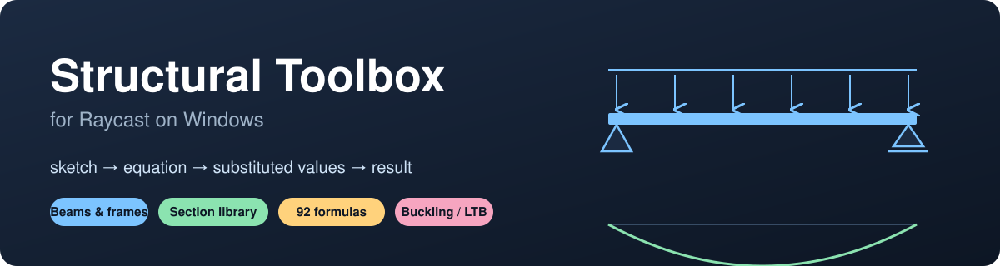
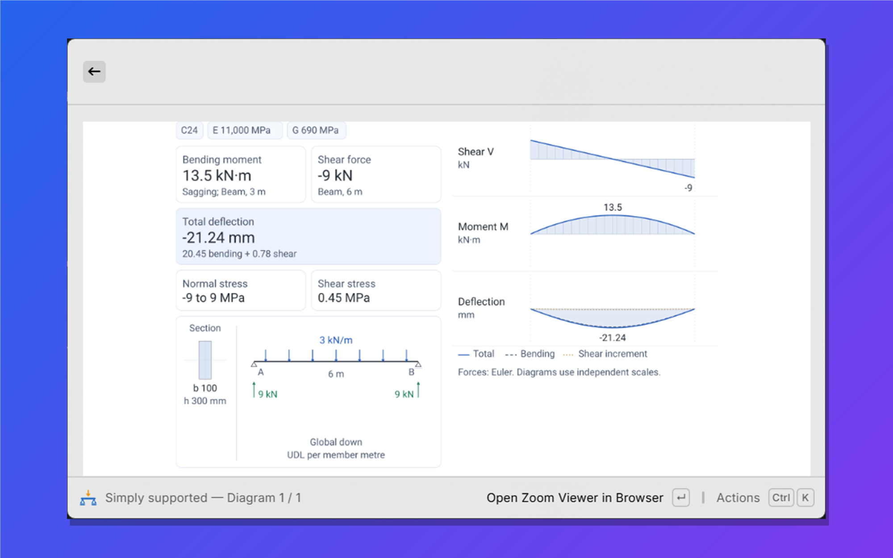
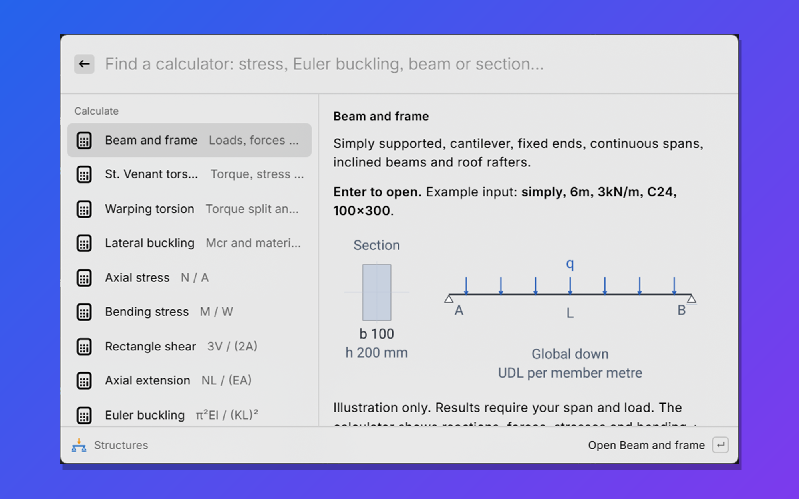
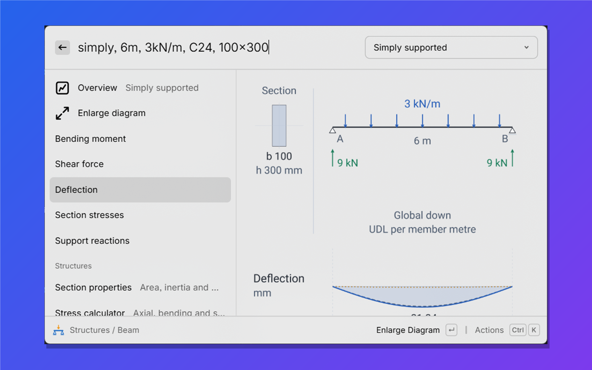
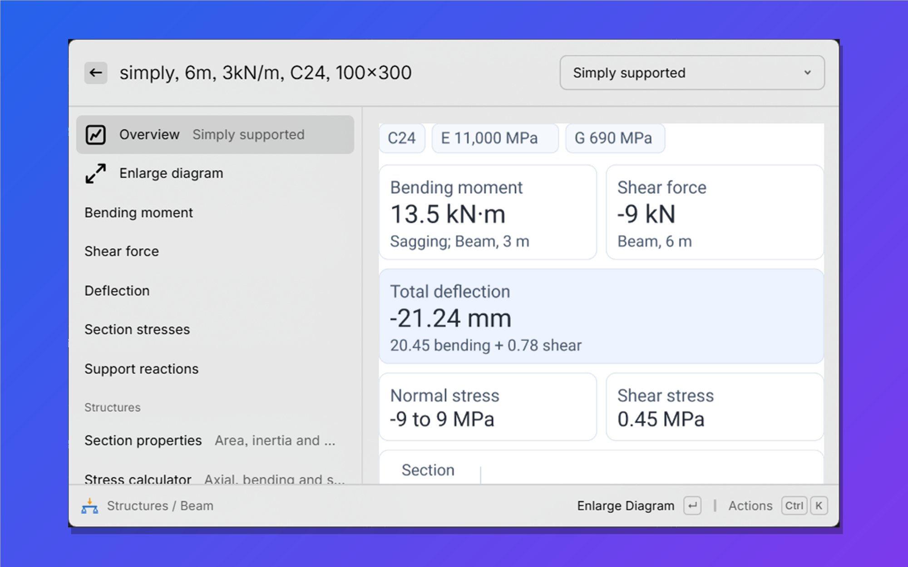
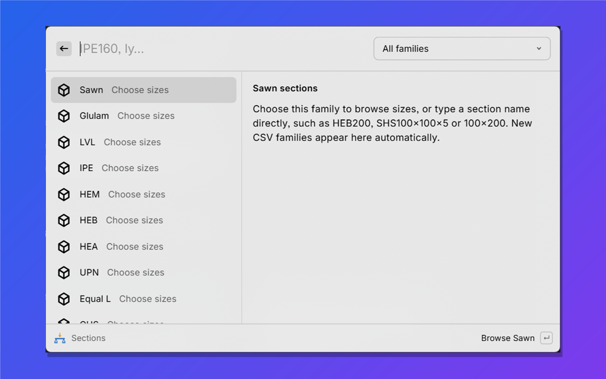
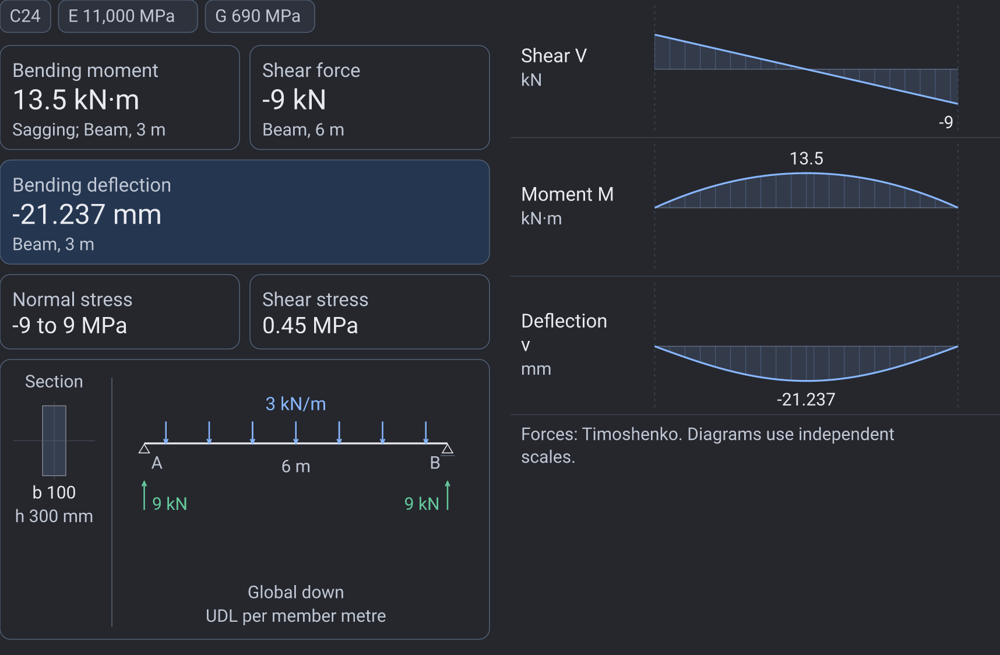
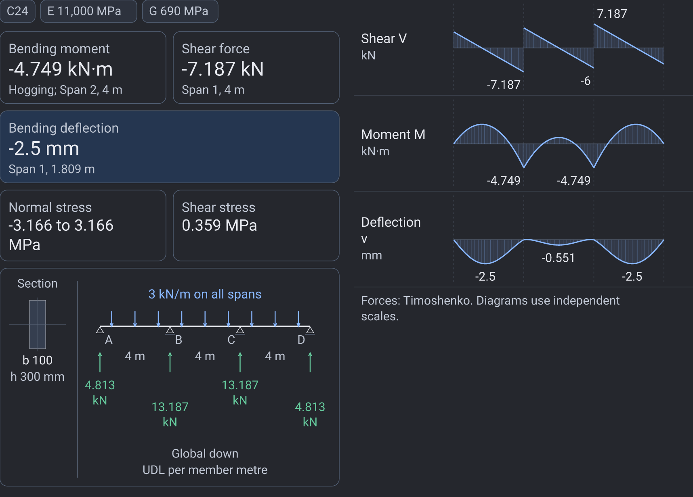
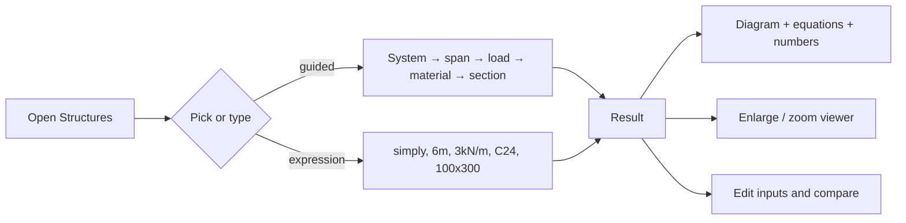

<p align="center"></p>

<p align="center">
  
  
  
  
</p>

**Quick structural engineering calculations inside Raycast that show the mechanics, not just a number:**
sketch → equation → substituted values → result. Everything is calculated locally; no AI or remote engineering API is involved.

> General elastic calculator and reference library. Eurocode design/resistance checks are intentionally **not** included.

---

## What you can do

| Type this in **Structures** | You get |
| --- | --- |
| `simply, 6m, 3kN/m, C24, 100x300` | Beam diagram, reactions, shear/moment/deflection curves, stresses |
| `cantilever, 4m, 10kN, at 40%, S355, IPE200` | Point load at 40 % of the span on a steel section |
| `rafter, 8m, pitch 30deg, global down, projected, 3kN/m, GL24h, 140x450` | Inclined roof rafter with a true-scale drawing |
| `continuous 5, 4m each, 10kN, span 2, at 40%, C24, 100x300` | Five-span continuous beam |
| `udl, 6m, C24, 100x300` | Lateral-torsional buckling factors |
| `T=1kNm, S355, IPE200, 3m` | St. Venant torsion |

You never need to remember the syntax: the suggestion list walks you through **system → span → load → material → section**, and the first suggestion is always highlighted so **Enter** accepts it.

## How a result looks

<p align="center"></p>

**Enlarge** shows the values *and* the diagrams together on one screen: result cards, section, loads and reactions, then shear, moment and deflection curves.

<table><tr>
<td></td>
<td></td>
</tr><tr>
<td></td>
<td></td>
</tr></table>

<sub>Screenshots are real Raycast windows. The result images can be regenerated with <code>npm run render:readme</code> (rendered by the extension's own diagram engine, shown below for the dark theme).</sub>

<p align="center"> </p>

## Three commands

| Command | Purpose |
| --- | --- |
| **Structures** | The calculators: beams/frames/trusses, stresses, section properties, Euler buckling, torsion, warping, lateral buckling, 92 reference load cases |
| **Library** | Browse and edit **48 materials** and **713 sections** (IPE, HEA/HEB/HEM, UPN, angles, SHS/RHS/CHS, timber, glulam, CLT…) |
| **Guide** | Examples, units, assumptions and how to edit the library |



## Feature map

| Area | Highlights |
| --- | --- |
| **Beams and frames** | 2D linear FE, 1–5 spans, pinned/fixed/roller supports, point/UDL/moment loads, inclined roofs, bending + shear (Timoshenko) deflection |
| **Sections** | y/z and principal axes, elastic/plastic moduli, shear areas, torsion constant, warping, first moments |
| **Stresses** | axial, bending, rectangle shear, with presets or custom geometry |
| **Stability and torsion** | Euler buckling (both axes), lateral-torsional buckling factors, St. Venant torsion, Vlasov warping torsion |
| **Reference library** | 92 arrangements: tent/triangular loads, guided ends, temperature gradients, pattern-load envelopes |
| **Data** | editable CSV materials and sections, extra catalogues auto-loaded, reload without restarting |
| **Visuals** | readable diagram text sizes, enlarge in Raycast, local zoom viewer, full-width view |

## Install (Windows)

1. Install **Node.js 22.22.2 or newer** and keep **Raycast** open.
2. Clone or download this repository.
3. Double-click **`Install.cmd`**. It installs dependencies, runs checks and calculations, builds, and imports the extension into Raycast.
4. Search Raycast for **Structures**. Keep the installer window open while you use the development extension.

No administrator rights are needed.

```text
npm ci
npm run typecheck
npm test
npm run build
```

## Documentation

| Read | For |
| --- | --- |
| [docs/REFERENCE.md](docs/REFERENCE.md) | Full user reference: every calculator, input rule, method and example |
| [ARCHITECTURE.md](ARCHITECTURE.md) | Developer map of every module, data flow and extension recipes |
| [CSV-SCHEMA.md](CSV-SCHEMA.md) | Add or edit materials and sections |
| [VALIDATION.md](VALIDATION.md) | Hand-method checks and what the tests do and do not verify |
| [DATA-AUDIT.md](DATA-AUDIT.md) | Data sources and known discrepancies |

## Limits

No code resistance, cracking, creep, geometric nonlinearity, dynamics or 3D analysis. Always confirm results against the applicable standard before using them for design.

## License

[Apache License 2.0](LICENSE). See [NOTICE](NOTICE).
